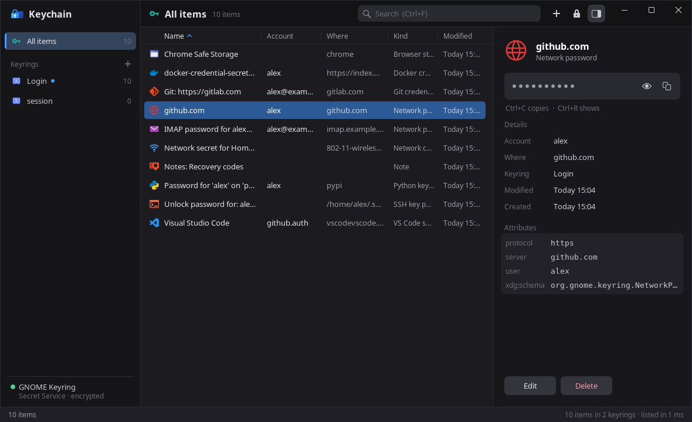

# Keychain Manager

**Your desktop's keyrings, at a glance.** Fast, keyboard-first, for Linux.

## Features
- **Works with the keyring you have**: GNOME Keyring, KWallet, KeePassXC or any Secret Service provider. It stores nothing itself.
- **Instant**: thousands of items listed in milliseconds; the window never waits on the keyring service.
- **Keyboard-first**: type to search names, accounts and attributes, `Ctrl+P` jumps to any item, every shortcut can be rebound.
- **Knows what things are**: web and Git logins, Wi-Fi keys, SSH and GPG passphrases, browser keys, mail accounts, each with its icon.
- **Copy safely**: secrets leave the clipboard after 30 s and are marked so clipboard histories skip them.
- **Edit everything**: secrets, names, attributes; new items with a password generator; copy or move items between keyrings.
- **Keyrings**: create, rename, lock, unlock, make default, delete; lock them all after a while without use.
- **Live**: changes made by other apps show up by themselves.
- **Careful with secrets**: encrypted transfers from the service, locked and wiped memory, no core dumps.
- **Looks like File Explorer**: the same GPU-drawn look, themes and title bar on every desktop; its theme is taken over on first run.

## Install
| Distro | How | |
|---|---|---|
| Debian 13, Ubuntu 25.10+, Mint, Pop!_OS | add the repo once, then `sudo apt install keychain-manager` ([commands](docs/install.md#debian-13-ubuntu-2510--2604--2610-mint-pop_os)) |  |
| Fedora 43 / 44 | add the repo once, then `sudo dnf install keychain-manager` ([commands](docs/install.md#fedora-43--44)) |  |
| openSUSE Tumbleweed / Leap 16 | add the repo once, then `sudo zypper install keychain-manager` ([commands](docs/install.md#opensuse-tumbleweed--leap-160)) |  |
| Arch, CachyOS, Manjaro, EndeavourOS | `makepkg -si` in `packaging/arch` of a clone ([commands](docs/install.md#arch-cachyos-manjaro-endeavouros)) |  |
| Any distro (Ubuntu 22.04+, Debian 12+...) | AppImage from [Releases](https://github.com/AlexMedela/keychain-manager/releases/latest) ([how](docs/install.md#any-other-distro-appimage)) |  |

It needs a keyring service running: GNOME Keyring, KWallet (Plasma), or KeePassXC with its Secret Service integration on.
Details: [docs/install.md](docs/install.md).

## First steps
| Key | |
|---|---|
| Type | Search names, accounts and attributes |
| `Ctrl+P` | Go to any item |
| `Ctrl+C` | Copy the secret (cleared after 30 s) |
| `Ctrl+R` | Show the secret |
| `Enter` | Edit the item |
| `Ctrl+N` | New item |
| `Ctrl+L` | Lock all keyrings |
| `Ctrl+,` | Options: themes, clipboard, auto-lock, keys |

All keys: [docs/keys.md](docs/keys.md)

## Docs
[Install](docs/install.md) · [Keys](docs/keys.md) · [Settings](docs/settings.md) · [Building](docs/building.md) · [Architecture](docs/architecture.md)

## Licence
[MIT](LICENSE). Bundled icons and libraries keep their own licences, listed in [Building](docs/building.md#third-party).
